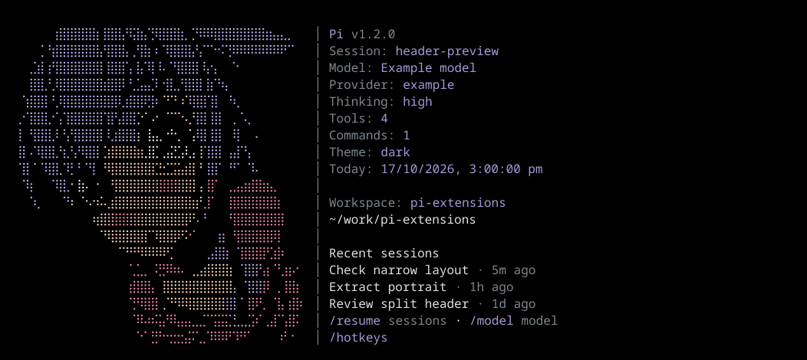

# pi-custom-header

A split startup header with a colored dot-art portrait, blinking eyes, workspace details, and three recent sessions.



Preview rendered with example session data. The running extension also blinks.

This extension is shared as source rather than published to npm so you can customize it for your own setup. Change the portrait, colors, metadata, or layout to suit your needs. The package stays private.

## Get only this extension

With Git and Pi already installed:

```sh
extensions_dir="${PI_CODING_AGENT_DIR:-$HOME/.pi/agent}/extensions"
mkdir -p "$extensions_dir/.sources" &&
git clone --depth 1 --filter=blob:none --sparse https://github.com/utpalsinghdev/pi-extensions.git "$extensions_dir/.sources/pi-custom-header" &&
git -C "$extensions_dir/.sources/pi-custom-header" sparse-checkout set packages/pi-custom-header &&
ln -s ".sources/pi-custom-header/packages/pi-custom-header" "$extensions_dir/pi-custom-header"
```

The clone stays inside `~/.pi/agent/extensions/.sources/pi-custom-header`. The symlink exposes its package as `~/.pi/agent/extensions/pi-custom-header`, which Pi discovers automatically. No `pi install`, settings edits, dependency install, or build is needed. Start Pi normally, or run `/reload` if it is already open. The snippet respects `PI_CODING_AGENT_DIR` if set. Sparse checkout includes repository root files but no other extensions.

To customize it, edit `lib/header-portrait.ts` for the dot art and blink frames, `lib/header-portrait-colors.ts` for colors, `lib/header.ts` for metadata and the split layout, or `lib/header-workspace.ts` for workspace details. These paths are available through `~/.pi/agent/extensions/pi-custom-header/` after the setup above. Run `/reload` after editing.

## Run from a full clone

From the repository root, with Node.js 22.19 or newer:

```sh
npm ci --ignore-scripts
npm run custom-header
```

This runs the pinned Pi version with only this extension loaded. It does not add anything to your saved package settings.

If you already have Pi installed:

```sh
pi --no-extensions --extension ./packages/pi-custom-header
```

To keep it enabled across sessions, install the cloned package by its absolute path:

```sh
pi install /absolute/path/to/pi-extensions/packages/pi-custom-header
```

Keep the clone at that location. Pi loads its TypeScript source directly. No build or npm release is needed. Verified with Pi 1.2.0.

Do not load another header extension alongside it. Pi displays whichever header was set last.

## Layout and behavior

Wide terminals show the portrait on the left and session information on the right, separated by a vertical line. Narrow terminals hide the portrait and keep the information in a single column. Every line is clipped to the available terminal width.

The metadata shows the Pi version, session ID, model, provider, thinking level, active tool count, extension/prompt/skill command count, theme, and local date and time. These values come from public Pi APIs. The personal version's fork status request and filesystem resource estimates are not included.

Workspace history comes from Pi's current session directory. It excludes the current session and sessions without messages. Each row uses the saved session name or first prompt, plus its age. History is a startup snapshot, refreshed on session changes and `/reload`, not scanned during rendering. Recent titles can contain prompt text, so check them before sharing screenshots.

Only the header changes. The editor, footer, tool output, keybindings, and session files stay unchanged. RPC, JSON, and print modes do not install the header.

Eyes blink after a random 1.6 to 2.6 second pause. There is no continuous animation loop. Animation stops when the portrait is hidden by a narrow terminal, when its eye row leaves regular-mode scrollback, or when the header is disposed.

To disable blinking:

```sh
npm run custom-header -- --header-static
```

Use `/builtin-header` to restore Pi's built-in header for the current session. Run `/reload` to enable the custom header again. Use `/hotkeys` to see your configured shortcuts.

## Verify

From the repository root:

```sh
npm run check
npm test
```

For an isolated interactive check:

```sh
PI_CODING_AGENT_DIR="$(mktemp -d)" npm run custom-header -- --offline --no-session --tui-mode regular
```

Repeat with `--tui-mode fullscreen`. No model credentials are needed to inspect the header.

- Check the split layout, portrait, and eye blink at a wide terminal size.
- Resize below the portrait breakpoint. Confirm that metadata remains and the portrait disappears.
- Try both a tall terminal and a short one. Scrollback must not be repeatedly redrawn by an offscreen eye animation in regular mode.
- Check empty history and a workspace with named sessions.
- Run `/builtin-header`, then `/reload`.
- Repeat with `--header-static` and confirm that the eyes stay open.

Automated checks cover width limits, every blink frame, Unicode titles, terminal-control sanitization, theme changes, real session discovery, timer cleanup, offscreen behavior, non-TUI guards, restoring the built-in header, and reload.

## License

[MIT](LICENSE).
